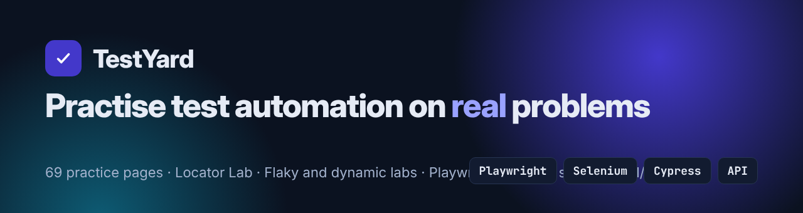
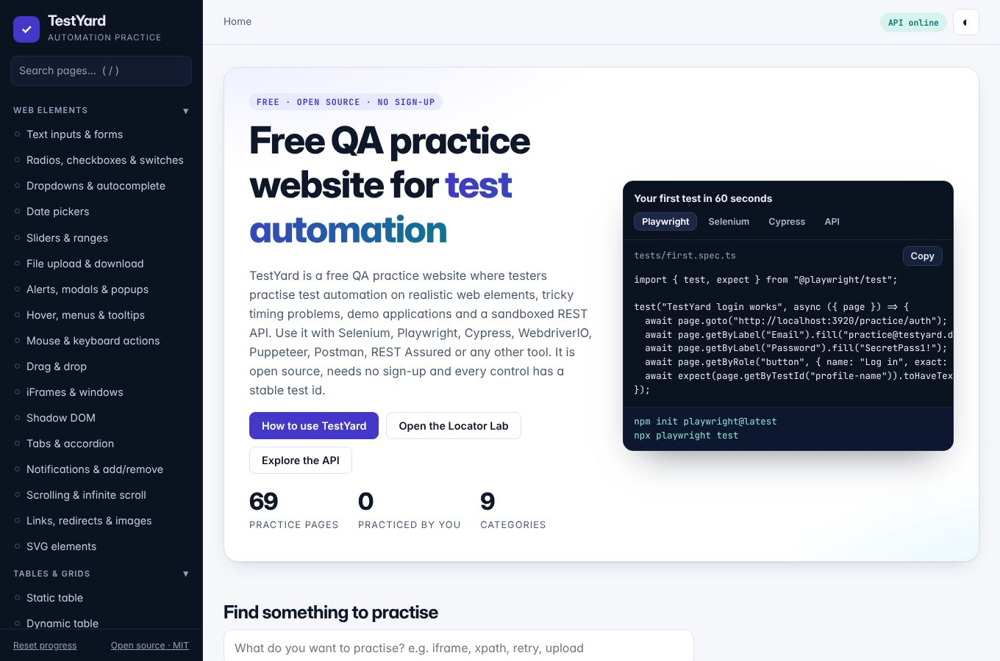
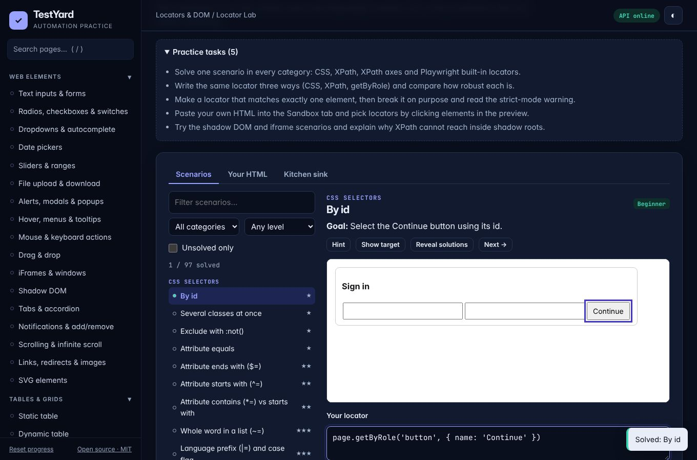
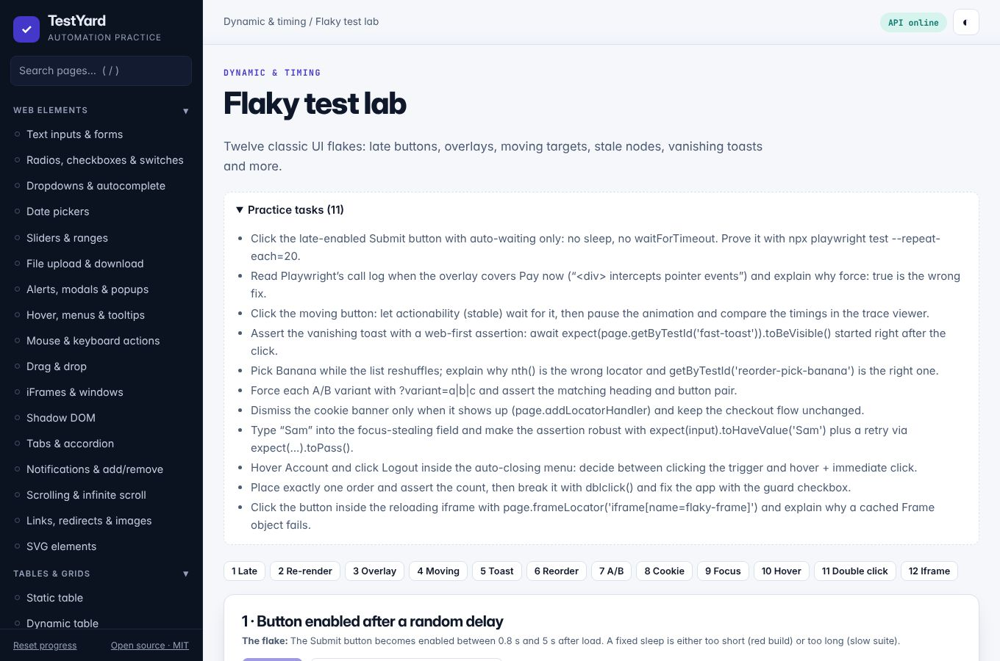
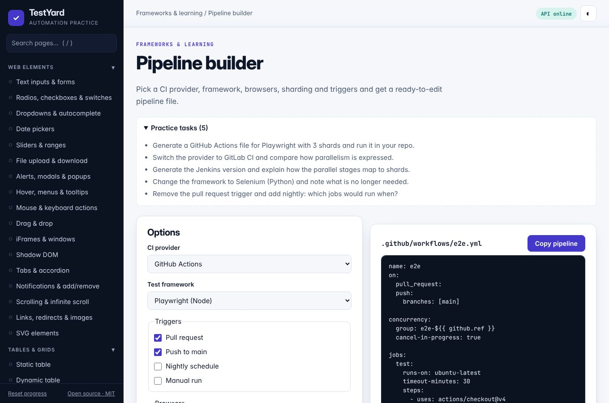
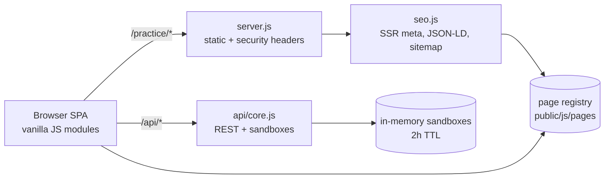

<div align="center">



# TestYard

**A free, open-source playground for Playwright, Selenium, Cypress and API testers.**
69 practice pages · a real sandboxed REST API · a 97-scenario Locator Lab · flaky and dynamic labs · framework and CI/CD guides.


[Quick start](#quick-start) · [What you can practise](#what-you-can-practise) · [Learning paths](#learning-paths) · [Locator Lab](#locator-lab) · [API](#the-api) · [How to use it](#how-to-use-it-effectively) · [Architecture](#architecture) · [Security](#security) · [Contributing](#contributing)

**Live demo:** `https://testyard.onrender.com/`

</div>

---

## Screenshots

<table>
<tr>
<td width="50%"><br><sub><b>Home:</b> quick start, page finder, learning paths</sub></td>
<td width="50%"><br><sub><b>Locator Lab</b> (dark theme): type any locator, see live matches</sub></td>
</tr>
<tr>
<td><br><sub><b>Flaky lab:</b> overlays, races, stale handles</sub></td>
<td><br><sub><b>Pipeline builder:</b> generates CI YAML</sub></td>
</tr>
</table>

## Why this project

Most practice sites give you a login form and a few dropdowns. Real suites fail on late-rendered elements, shadow DOM, iframes, race conditions and flaky pipelines. TestYard puts those problems in front of you, with stable `data-testid` hooks, a task list on every page, and an API you can break without consequences. It is also a portfolio piece: a zero-dependency Node server, a vanilla-JS single-page app, server-side SEO, a security-hardened API, and a tested codebase.

## Quick start

Requires Node.js 18+. There are **no dependencies and no build step**.

```bash
git clone https://github.com/Pranavchvn7/testyard.git
cd testyard
npm start            # http://localhost:3000
```

Then open the **Home** page: its *Quick start* card shows a ready-to-run snippet for Playwright, Selenium, Cypress or the API against your own address.

<details>
<summary><b>Run the tests</b></summary>

```bash
npm test             # API + security + SEO tests (node:test, no browser)
npm run test:e2e     # browser tests; needs Playwright: npm i -D playwright && npx playwright install chromium
```
</details>

<details>
<summary><b>Try it in 30 seconds with Playwright</b></summary>

```js
import { test, expect } from "@playwright/test";

test("log in on the practice site", async ({ page }) => {
  await page.goto("http://localhost:3000/practice/auth");
  await page.getByLabel("Email").fill("practice@testyard.dev");
  await page.getByLabel("Password").fill("SecretPass1!");
  await page.getByRole("button", { name: "Log in", exact: true }).click();
  await expect(page.getByTestId("profile-name")).toHaveText("Practice User");
});
```
</details>

## What you can practise

| Area | Pages | What you get |
|---|:--:|---|
| **Web elements** | 17 | Forms and validation, radios/checkboxes, dropdowns and autocomplete, date pickers, sliders, upload/download, JS dialogs and modals, hover, mouse and keyboard, drag and drop, iframes and windows, **shadow DOM**, tabs, toasts, infinite scroll, links and broken images, SVG |
| **Tables and grids** | 3 | Static, dynamic (column order shuffles on each load), 120-row grid with sort, filter, paginate, select, delete |
| **Dynamic and timing** | 15 | Async controls, hidden vs late-rendered elements, flaky API and stale elements, slow images, unstable UI, a **flaky test lab** with a diagnosis guide, lazy loading, polling and progress bars, type-ahead races, lazy tabs, changing states, network waits |
| **Locators and DOM** | 5 | Dynamic ids, challenging DOM, 2,500-cell table and 40-level tree, the **Locator Lab**, and a searchable **locator cheat sheet** |
| **Playwright lab** | 12 | Actionability, web-first assertions, network mocking, API testing, auth and storageState, multi-context, frames and shadow DOM, dialogs/downloads/uploads, keyboard and mouse, clock control, emulation, visual and accessibility testing |
| **Demo apps** | 5 | Login/register/forgot/OTP, Notes (CRUD), e-commerce shop (cart to order), 4-step flight booking, calculators |
| **API lab** | 3 | Live OpenAPI reference, Postman-style request console, API test challenge checklist |
| **Learning and tools** | 9 | 22-step framework roadmap with starters (Playwright TS/JS, Selenium Python/Java, Cypress, API, BDD, k6, axe, visual), CI/CD guides (GitHub Actions, Jenkins, GitLab, Azure, CircleCI, Bitbucket, Docker and reports), a **pipeline builder** that generates YAML, tool cheatsheet, HTTP/browser diagnostics |

## Learning paths

The Home page tracks your progress on each path (stored in your browser). Pick the one that matches your goal:

| Path | Who it is for | Route |
|---|---|---|
| **Manual tester starting automation** | First automation steps | Inputs, choices, dropdowns, static table, dynamic loading, Locator Lab, auth demo app |
| **Playwright engineer** | Modern Playwright skills | Locator Lab, cheat sheet, actionability, assertions, network, auth/storageState and more |
| **Selenium engineer** | Waits and tricky elements | Inputs, dropdowns, frames, shadow DOM, dynamic controls, flaky page, framework guide, CI |
| **API tester** | From first GET to contracts | API docs, console, challenge checklist, Playwright API testing, framework, CI |
| **Flaky test hunter** | Stabilising suites | Diagnosis guide, flaky lab, network and state/time flakiness, type-ahead race, polling, clock |
| **SDET and framework builder** | Framework and CI design | 22-step roadmap, locator strategy, CI pipeline, GitHub Actions, Docker reports, pipeline builder |

## How to use it effectively

**First 15 minutes**
1. Run the app and open **Home**. Pick the learning path that matches your goal and follow it step by step; ticks are saved in your browser.
2. Copy the **quick-start snippet** for your tool and run it against your own address to confirm your setup works.
3. Open any practice page and read its **practice tasks**. Each one is a small, concrete automation goal.

**A practice loop that works**
1. Write the automation for one task using only stable hooks (`data-testid`, roles, labels). Avoid sleeps.
2. Break your own test on purpose: slow the network, reload mid-test, run it 20 times. Fix what turns flaky.
3. Re-do it with a second tool (for example Playwright, then Selenium) and compare how each handles waiting and locators.
4. Move the working test into the starter under [`frameworks/`](frameworks), then wire it into CI with the pipeline builder.

**Where to go when you are stuck**

| Problem | Go to |
|---|---|
| Can't find the right locator | Locator Lab, then the locator cheat sheet |
| Test passes sometimes | Flaky lab and the flaky diagnosis guide |
| Element appears late or changes | Dynamic and timing pages |
| Need a backend to test | API lab, request console and sandboxes |
| Not sure how to structure a project | 22-step framework roadmap |

## Locator Lab

One place to practise every kind of locator: **CSS, XPath (functions and axes), Playwright selector strings and the `getBy*` API** including `filter`, `and`/`or`, `nth`, `frameLocator` and shadow piercing.

- 97 scenarios, each verified programmatically inside the same iframe the lab uses
- Type a locator, get live match counts and highlighting, plus detection of which locator kind you wrote
- Click an element to get suggested locators; paste your own HTML into the sandbox
- Backed by a dependency-free locator engine ([`public/js/locator-engine.js`](public/js/locator-engine.js)) with no `eval`

## Framework starters

Runnable examples that target TestYard live in [`frameworks/`](frameworks):

| Folder | Contents |
|---|---|
| [`frameworks/playwright`](frameworks/playwright) | Playwright starter (config, page objects, tests) |
| [`frameworks/selenium-python`](frameworks/selenium-python) | Selenium + pytest starter |
| [`frameworks/cicd`](frameworks/cicd) | Jenkinsfile, GitLab, Azure, CircleCI, Bitbucket, Docker and compose files |

## Architecture



Design choices worth noting: one page registry feeds both the SPA and the server-rendered SEO output; the CSP allows no inline scripts and fonts are self-hosted; sandboxed API data is isolated per `X-Sandbox` id.

<details>
<summary><b>Project layout</b></summary>

```
server.js              hardened static + SEO + API server (no dependencies)
seo.js                 titles, meta, JSON-LD, nav, sitemap and robots from the page registry
api/core.js            the REST API (routes, validation, sandboxes, rate limits, OpenAPI)
public/                the single-page app (clean-URL routing, vanilla JS modules)
  js/home.js           the guided Home page
  js/pages/*.js        one module per group of practice pages
  js/locator-engine.js CSS / XPath / Playwright locator evaluator
  fonts/               self-hosted Inter and JetBrains Mono (OFL)
tests/                 API, security/SEO and Playwright tests
frameworks/            runnable starters and CI examples
docs/images/           README banner and screenshots
```
</details>

<details>
<summary><b>Adding a practice page</b></summary>

```js
// public/js/pages/my-page.js  (import it in public/js/app.js and add its file name to the list in seo.js)
import { page } from "../registry.js";
import { h, stage } from "../ui.js";

page({
  id: "my-page", group: "elements", title: "My page", blurb: "What it teaches.",
  tasks: ["First thing to automate"],
  render(root) { root.append(stage(h("button", { "data-testid": "go" }, "Go"))); },
});
```

`npm test` enforces unique titles (70 characters or fewer), descriptions of 50 to 160 characters, and no stray `console.log`, `debugger` or TODO in shipped code.
</details>

## The API

* Base URL: `<your-host>/api` · OpenAPI document: `/api/openapi.json` (import into Postman, Insomnia or Bruno)
* **Sandboxes:** send `X-Sandbox: <any-id>` and you get your own isolated data (users, accounts, notes, orders). The browser UI generates one automatically. Data lives in memory for 2 hours; the shared default sandbox is wiped every 30 minutes, so always send your own id.
* Demo account: `practice@testyard.dev` / `SecretPass1!`
* Features to test against: CRUD, pagination, bearer auth, OTP with lockout, account deletion, validation errors, `204`/`400`/`401`/`404`/`405`/`409`/`413`/`429`, `Retry-After`, redirects, delays, flaky responses, file upload/download, Basic auth.
* Limits: 600 requests/minute per IP, 60 sign-up/login calls/minute per IP, 10 failed logins per account per minute, 100 KB JSON bodies, 1 MB per uploaded file.

## Security

TestYard ships hardened: strict Content-Security-Policy with no inline scripts, `X-Frame-Options`, HSTS, scrypt password hashing, per-IP and per-account rate limits, request-size caps, generic error responses with correlation ids, and no runtime dependencies. Some behaviours are deliberately weak because they are the thing being practised; they are listed in [SECURITY.md](SECURITY.md), together with how to report a vulnerability. **Never enter real personal data.**

## Contributing

Issues and pull requests are welcome: new element types, harder edge cases and extra API endpoints are especially useful. Keep pages dependency-free, give every control a `data-testid`, and run `npm test` before opening a PR.

## License

MIT. See [LICENSE](LICENSE).
